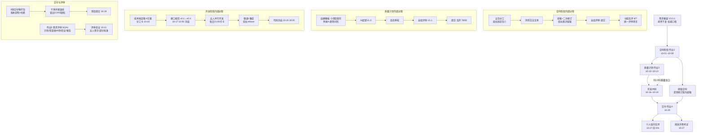

# SQA2 过程总结与资产沉淀

> **文档版本**：V1.0（2026-10-26）｜**编制**：组长（ZCode 辅助，AI 台账第 83 行）｜**性质**：过程资产文档（活文档，期末考试后归档）
> **编写依据**：①2026-10-23 课堂要求——评审活动总结、过程经验定义并文档化、总结不足并改进、资产沉淀（组长笔记 20 条之 TODO 项）；②课件《Oct 23.pdf》两讲（软件质量度量、软件质量基础设施部件）；③本组全程事实记录 `AGENTS.md` v1.74。
> **一句话定位**：把本组"合同→质量计划→开发→测试→评审→交付"全过程**定义化、文档化、流程图化**，用 GQM 找出不足与改进，并把可复用成果沉淀为**组织级资产库**。

---

## 1. 项目全流程总结（流程图＋过程定义）

### 1.1 全流程图

### 1.2 各阶段过程定义（输入／输出工件）

> 呼应课堂要求"是否满足计划开始的状态——准备工作（输入和输出工件）"：每个阶段开工前检查输入是否齐备，收口时输出工件可核查。

| 阶段 | 输入工件 | 过程活动 | 输出工件 | 评审关口／基线 |
|---|---|---|---|---|
| 合同（作业2） | 需求框架 V3.3.1、受托方模板、讨论区澄清 9 条 | 五包分工→独立起草→环形交叉互审→组长统稿＋二次修订→全组评审 | `合同草案_SQA2.docx`、评审记录、统稿修改记录 | **合同基线**：10-09 提交（14 条正文＋3 附件＋24 项验收指标）；后续澄清修订版作受控更改 |
| 质量计划（作业3） | 合同附件1 24 项指标、SQAP 模板、教材第10章/第八/九章 | 自建模板按小项目裁剪→AI 起草→组员审校→全组评审 | `质量计划_SQA2.docx` V1.1（M1–M6 关口、R1–R5 评审、风险检查表 10 项） | **计划基线**：V1.1 全组评审通过；R1–R5 关口对齐里程碑 |
| 需求与设计 | 需求框架、两轮澄清答复、接口规范 | 澄清问题清单回填、SRS 细化、接口规范五版迭代 | 需求规格说明书、`接口规范_SQA2_20261016.md` v0.4 | **接口基线**：10-17 12:00 冻结 v1.0，改动须群确认＋文档记变更 |
| 开发 | 冻结接口、技术栈 A 方案、分工卡 | 五人并行→每日 21:00 push 打卡→组长 rebase 集成→字段对齐 | 前后端工程、导入脚本（2806 入库/668 隔离）、48 项后端测试 | **代码基线**：10-19 18:00 冻结；缺陷收敛后不再动 |
| 测试 | 24 项验收指标、校验引擎、可运行系统 | 测试计划→70 项用例（后端 48＋Vitest 5＋E2E 17）→B-01 全量 2806 条正确性检查 | `测试文档`（计划/用例/报告）、24 项指标全通过记录 | **测试基线**：R4 检查表 11 项核对 |
| 交付（作业4＋项目） | 全部工件、运行说明、演示视频 | 8 项打包→版本说明＋SHA256 哈希→**干净环境演练**（查出 CORS 缺陷并修复）→签署→提交 | `项目资料_SQA2.zip` V1.3、`合同终版_SQA2.zip` | **交付基线**：`archive/final-20261021` 分支＋归档快照；R5 检查表 13/13 完全批准 |
| 技术评审（作业5） | SQA1 交付包、GB/T 8567/9385/830 | 评审计划→检查表 49 项四态核查→评审会议（五则裁决＋P01–P17 逐条表决）→DR 报告与跟踪 | `作业5_SQA2.zip`（四件套＋签字）；对 SQA1 结论＝**部分批准（有条件通过）** | **评审结论三态**落地实践；改进项书面确认后转完全批准 |

### 1.3 与课件概念的对应（本组做对了什么）

- **评审＝阶段放行闸门**（Oct 13 p53）：R1–R5 关口＋作业2/3 互评＋作业5 DR，每个阶段"能不能往下走由评审决定"在本组真实执行（如接口冻结前做了正式冲突审查）。
- **检查表＝评审完备性工具**（Oct 13 p69/p74）：从 R1–R5 五张关口表到作业5 的 49 项四态检查表，回应了讲评"没人做 checklist"。
- **基线三要素**（Oct 23 p98–100）：本组五条基线（合同/计划/接口/代码/交付）全部是"**通过正式评审的正式文本＋一组配置项＋只能走变更控制修改**"——澄清修订版合同（走组长批准的修订说明）、接口 v1.0 冻结后群确认制度，就是变更控制流程的实例。
- **"不会变更的内容不纳入基线"**（笔记 18 条）：演示数据、临时脚本、.gocache 类产物从不进 Git 与基线（.gitignore＋红线清单）。
- **基线的属性＝名称、标识符、版本、日期**（笔记 19 条）：落到本组即"文件名_SQA2＋版本号 Vx.y＋修订历史表日期行"的命名与版本制度。

---

## 2. 基础设施部件对照（本组的 SQA 基础设施）

> Oct 23 课件主体六部件 × 本组实例。目标：**预防故障（或降低故障率）＋提高生产率**（课件 p14）。

| 基础设施部件（课件） | 本组对应实践（资产位置） | 成熟度自评 |
|---|---|---|
| ① 规程与工作条例 | 《组员协作规约》（双层同步、git 军规、冻结纪律）、命名规范、AI 登记制度、对外提问走讨论区公开帖规则 | 规程已成文并执行；工作条例（个人级）散见于分工卡 |
| ② 模板与检查表 | 自建质量计划模板（附录A SQAP 裁剪对照）、R1–R5 检查表、需求评审检查表 49 项、评审四件套结构、合同附件写法 | **本组最强项**：检查表从无到有并对外输出（作业5） |
| ③ 员工培训与认证 | 新组员（及其 AI 助手）onboarding 包：AGENTS.md→README→CLAUDE/GEMINI 入口链、全量包＋协作规约=培训教材、"较好的协调＝较少的错误"靠接口冻结＋每日打卡实现 | 培训以"体系文件自解释"替代讲授，适合 5 人小团队 |
| ④ 改正性和预防性措施（CAPA） | 评审问题 P01–P17 逐条表决与跟踪、缺陷四级分类、作业3 补交教训→"提前 24h"军规（作业4/5 已执行）、v1.67 归档覆盖事故→"覆盖前先改名"军规 | CA 强、PA 偏弱（见 §3 改进项 G4） |
| ⑤ 配置管理 | GitHub 仓库（代码权威）＋课程文件夹（口径权威）双层库；接口/代码/交付三条冻结线；分支 main＋`archive/final-20261021`；交付包哈希；版本说明 V1.3 | 有库有基线有变更控制；缺独立 SCMP 文档（小项目裁剪，质量计划 §7 已覆盖） |
| ⑥ 文档编制控制 | 修订历史表制度（每份正式文档首页）、"名称_SQA2"命名、过程稿加日期后缀、只读区（`01_老师下发` 勿改）、归档目录 | 执行良好；修订历史在全部 10+ 份正式文档落地 |

**规程分层实践**（笔记 14 条，课件 p21 分层结构）：国家标准层（GB/T 8567-2006、GB/T 9385-2008、IEEE 830）→ 机构方针层（需求框架 V3.3.1＝甲方要求、老师澄清口径）→ 机构规程层（协作规约、接口规范、质量计划）→ 工作条例层（分工卡、个人任务清单）。下层不得与上层冲突——接口规范 v0.4 终审修正（teacherType、违规确认权限归 librarian）正是"对齐上位层"的实例。

**规程与工作条例之别**（笔记 15 条，课件 p27）：规程＝全组普遍适用的活动定义（如"每日 21:00 前打卡""冻结后改动须群确认"）；工作条例＝特定角色对规程的局部细化（如陈彬的"统稿前先跑自动校验"），不得冲突。

---

## 3. GQM 度量与过程不足改进（CAPA）

### 3.1 GQM 表（目标→问题→度量）

> 呼应笔记 5 条"前序文档作为不足改进的参考——GQM"。数据收集遵守课件 5.3 原则：**有用且不成为负担**——全部取自已有记录（提交时间戳、git log、检查表、台账），未新增采集负担。

| # | 目标 Goal | 问题 Question | 度量 Metric | 本项目实测 | 结论 |
|---|---|---|---|---|---|
| G1 | 按期交付 | 是否踩过截止时刻？ | 各作业提交时刻−截止时刻 | 作业2/4/5 提前 12h+；**作业3 补交 1 次**（上限 90 分） | 4/5 达标；补交教训已转化为军规 |
| G2 | 评审有效性 | 评审查出多少缺陷？事后流出多少？ | 评审问题数与分级；被评方返修率 | 对 SQA1 查出 P01–P17（严重 8 项）；本组交付自查 49 项反向核对 46 符合/2 部分/1 轻微 | 评审是本组最有效过滤器（印证 IBM 1:6.5:15:60~100） |
| G3 | 需求一致性 | 实现/文档与需求框架的偏差数？ | R1 检查表符合率；SRS 与框架冲突数 | R1 18/18 符合；交付自查 0 严重问题 | 达标 |
| G4 | 文档质量 | 版式/占位符类缺陷？ | 自动校验通过率（17 项合同校验、9 项版式检查、postcheck 0 错误） | 全部通过；但出现过目录制表位、加粗范围等**校验器覆盖不到**的缺陷 | 需补视觉验收（已加） |
| G5 | 工作量均衡 | 各成员投入是否对齐分工卡？ | 分工卡完成率；互评分差 | 8/8 交付物全有责任人；互评分差 88–96（合理差异） | 达标 |
| G6 | 过程资产 | 可复用资产是否沉淀？ | 资产清单条目数（§4） | 14 项（§4） | 新建目标，本期达成 |

### 3.2 过程不足与改进措施（CAPA 表）

> 呼应笔记 4/10/11 条："总结有啥不足""过程中有什么不足，进行改进"。

| # | 不足（事实） | 根因分析 | 改正性措施 CA（已做） | 预防性措施 PA（下个项目） | 跟踪 |
|---|---|---|---|---|---|
| C1 | 作业3 质量计划补交（全班唯一，他组评分上限 90） | 提交截止与作业2 互评同刻、又夹在开发冲刺，排期未留缓冲 | 组内接受，写入易错点 | **内部节点统一提前 24h**（作业4 于 10-19 深夜、作业5 于 10-23 12:00 前均已提前）——已固化为军规 | 组长，每次作业 |
| C2 | 开发冲刺仅 3 天（10-16 才实际开工） | 合同/质量计划阶段吃掉日程，技术栈 10-16 才定 | 全员并行＋接口先冻结降低耦合 | 需求确定后**立即搭骨架与定技术栈**，文档类作业与开发并行推进 | 组长 |
| C3 | 评审组长无法满足"项目组之外"理想条件（Oct 13 p63–66） | 课程形式=组间结对互评，客观限制 | 用国标（GB/T 9385 等）＋检查表 49 项弥补独立性不足；非本组材料评审人=全组 | 结对外可协商交换更早的时间窗，保证会前读文档时间 | 评审组长 |
| C4 | 检查表起步晚（10-16 才建 R1–R5；此前质量计划已提交） | 初期未识别"检查表=评分着眼点"（3.7.A-12） | R1–R5＋49 项检查表补齐并随评审归档 | **资产库化**（§4）：任何新项目开工第一天即复用本组检查表模板 | 陈彬（SQA） |
| C5 | 归档覆盖事故：v1.67 贴图版被 v1.68 覆盖无副本 | 覆盖归档快照前未改名 | 事故记入台账 | **覆盖任何归档/定稿前先改名留副本**——已成文为操作军规 | 组长 |
| C6 | 预防性措施整体弱于改正性（问题多在评审/事后被发现） | 小团队无独立 QA 角色，SQA 由陈彬兼任且偏产品侧 | 已在测试文档中建立缺陷四级与跟踪 | 每个关口设置"准入检查"（输入工件齐备才开工，见 §1.2），把发现左移 | 组长 |

---

## 4. 资产沉淀清单（组织级资产库）

> 呼应笔记 4/11/12 条："资产沉淀""形成自己的检查表（自己的资产）"。以下资产在**下一个同类项目**中可直接复用。

| # | 资产 | 类型 | 位置 | 复用场景 |
|---|---|---|---|---|
| A1 | AGENTS.md（项目过程数据库，v1.75） | 体系文件 | 项目根 | 任何项目开箱即用的"组织级记忆"模板：澄清管理/日期表/易错点/修订历史 |
| A2 | 组员协作规约 | 规程 | `SQA2_工作区/组员协作规约_SQA2_20261016.md` | 多人＋多 AI 协作的双层同步机制 |
| A3 | 接口规范 v0.4（含审查方法论） | 规程 | `SQA2_工作区/接口规范_SQA2_20261016.md` | 前后端契约冻结流程：起草→对照需求原文终审→冻结→变更留痕 |
| A4 | R1–R5 关口检查表 | 检查表 | `SQA2_工作区/文档/评审检查表_R1-R5_SQA2_20261016.md` | 需求/设计/代码/测试/交付五类评审直接套用 |
| A5 | 需求评审检查表（49 项四态） | 检查表 | `SQA2_工作区/作业5_需求评审_SQA1_20261020/` | 对任何 SRS 的技术评审：可直接换成被评审文档复用 |
| A6 | 评审四件套结构（计划/检查表/会议记录/报告） | 模板 | 同上 | DR 全套文档骨架，含结论三态与逐条表决表 |
| A7 | 自建质量计划模板＋SQAP 裁剪对照法 | 模板 | `SQA2_工作区/文档/质量计划_SQA2.docx` | 小项目质量计划快速裁剪（附录A 方法可迁移） |
| A8 | 合同五包分工＋统稿裁决流程 | 规程 | `SQA2_工作区/合同/`（任务卡＋统稿修改记录） | 任何长文档的分包-互审-统稿协作 |
| A9 | 互评"统一评审意见"方法论 | 规程 | `合同/合同互评统一评审意见` ×2、`文档/质量计划互评统一评审意见` | 多人评分整合裁决：收集→均值/证据裁决→可粘贴评语→一人提交 |
| A10 | 交付打包清单＋版本说明＋哈希制度 | 规程 | `SQA2_工作区/交付打包_20261020/打包清单.md` | 交付前 8 项核对＋SHA256 存证 |
| A11 | 扫描版 PDF 读取流程（PyMuPDF 200dpi 渲染＋WinRT OCR） | 工具 | AGENTS.md 4B 技术沉淀节 | 无文字层 PDF/国标扫描件的批量读取 |
| A12 | docx 自动校验脚本集（占位符/版式/制表位/字号统一） | 工具 | C 盘 temp 各次脚本（可归集） | 交付前机器检查＋视觉验收双保险 |
| A13 | 演示数据集＋隐私虚拟化规则 | 数据 | `01_老师下发/选择1基础数据`＋导入隔离记录 | 真实数据脱敏/虚拟化的判例（668 条隔离原因可复用） |
| A14 | AI 使用台账制度（83 行） | 规程 | `SQA2_工作区/AI使用登记.md` | AI 辅助开发的合规留痕（对应框架第 4 章第 9 条） |

---

## 5. 期末考点关联速查（笔记 20 条 ↔ 课件页码）

> 10-27 开卷考试（15 分钟 20 道选择题共 10 分＋主观题）。主观题大概率考"用本组过程分析问题"，本文件 §1–§4 即答题素材。

| 笔记条目 | 课件出处 | 一句话要点 |
|---|---|---|
| 1 质量跟踪计划 | Oct 23 p4–5 | 度量数据收集六步（建目标→问题清单→数据类别→收集形式→采集验证→分析），与配置管理/变更控制合并才高效 |
| 2 评级最好是高一级的 | p46 | 认证需求之"候选者**直接上级**的评价" |
| 5 GQM | 度量章 | 目标→问题→度量，前序文档作为改进参考（本文件 §3.1） |
| 6 基础设施部件 | p10–15 | 六部件：规程与工作条例/模板与检查表/培训认证/CAPA/配置管理/文档控制；目标=预防故障+提高生产率 |
| 12/13 规程的益处 | p18 | 统一执行、有效交流，**较好的协调意味着较少的错误** |
| 14 规程分层 | p21 | 国家标准→机构方针→机构规程→工作条例 |
| 15 规程固定内容／与条例之别 | p22–23、p27 | 固定内容表 9 项；规程=机构普遍适用，条例=局部细化且不得冲突 |
| 16–19 基线 | p97–103 | 基线=**通过正式技术评审**的产品，只能经**正式变更控制**修改；一组配置项构成相对稳定逻辑实体；不会变更的不纳入；属性=名称/标识符/版本/日期 |
| 17 需求基线/变更流程 | p98、p113–119 | 需求通过正式评审即成基线；变更走 CCB：提交→接收→评估→决策→实现→验证→完成 |
| 20 流程图 | — | 本文件 §1.1 |

---

## 6. 维护说明

- 本文件为**活文档**：期末考试后随归档快照封版（预计 V1.1 冻结于 2026-10-28）。
- 若老师设置"过程总结/资产沉淀"类作业入口（作业6），本文件即为提交底稿，届时按命名规范另存正式件。
- 下一个项目复用时：§1.2 过程定义表、§3.2 CAPA 表、§4 资产清单为直接继承项；§3.1 GQM 需按新项目目标重定。
